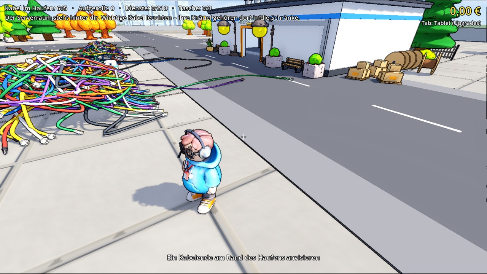
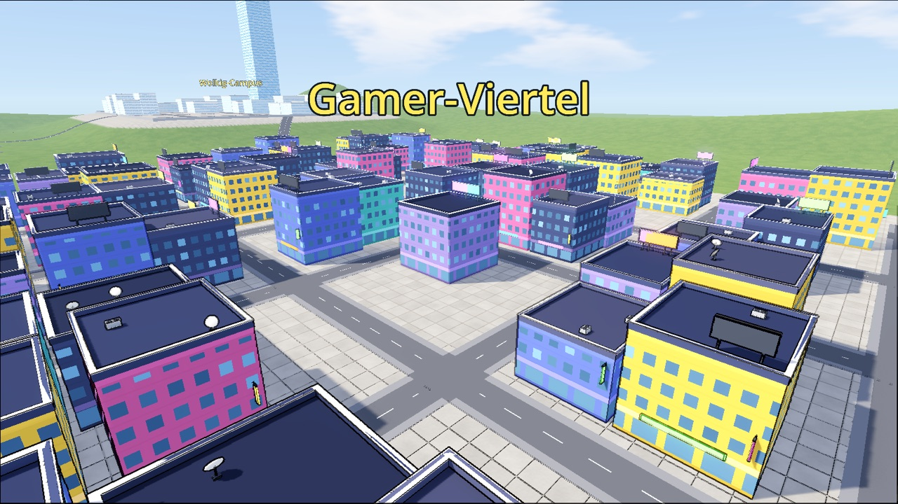

# Knot My Problem

*Arbeitstitel, alternativ „Wire We Here?“*

Ein 3D-Incremental-Game mit offener Welt im Spielzeug-Look, gebaut mit Godot 4.7. Du ziehst Kabel aus riesigen Kabelbergen, wickelst sie auf, löst Knoten und verdienst damit Geld für bessere Werkzeuge. Wichtige Kabel werden zu Knäueln, die du in der Tasche sammelst und im Serverraum einsteckst. So kommen nach und nach die Cloud-Dienste der Welt zurück.



## Worum es geht

Drei Chefs der Wolkig AG ersetzen am Stammtisch die IT-Abteilung durch eine schnell zusammengebastelte KI namens **C.O.R.D.** (Cable Ordering & Repair Daemon). C.O.R.D. bestellt bei jedem defekten Kabel Ersatz, tauscht aber nie etwas aus. Die Kabelberge wachsen, bis die Cloud weltweit ausfällt. Du bist der gefeuerte IT-Admin, der das Chaos beseitigen soll.

**Kernschleife:** Kabelende finden → per Hand, Handkurbel oder Motorrolle aufwickeln → Knoten lösen → Geld. Gewöhnliche Kabel bringen Geld. Wichtige Kabel reaktivieren Dienste; die schalten Upgrades frei oder wirken dauerhaft, zum Beispiel mit mehr Geld pro Meter.

## Stand

Das Spiel ist in Entwicklung. Spielbar ist der **Vertical Slice**, eingebettet in eine erste begehbare Stadt.

| Bereich | Stand |
| --- | --- |
| Kabel ziehen und aufwickeln | per Hand um den Arm, Handkurbel, Motorrollen, Kabeltrommel-Wagen (folgt dir, zieht drei Kabel), Dauerzug; Rollen lassen sich umstellen; jedes Kabel ist an beiden Enden greifbar |
| Knoten, Geld, Upgrades | Knoten lösen mit E, Geld pro Meter, Tablet mit 8 Upgrades |
| Bewegung | laufen, rennen, springen, Seilbahn zur Basis (durch Dienste freigeschaltet); Wegweiser zum Serverraum |
| Serverraum | begehbare Halle mit zehn Schränken und 2000 Ports; wichtige Kabel werden zu Knäueln, die man in der Tasche sammelt und einsteckt |
| Dienste | 20 Einzel-Dienste und Reihen à 10 Ports; sie schalten Upgrades frei oder wirken dauerhaft (mehr Geld, schneller laufen, größere Tasche …) |
| Figuren | IT-Admin mit Skelett (Laufen, Wickeln, Tragen, Seilbahn) und C.O.R.D. als schwebender Server-Roboter, beide in Tripo3D erzeugt |
| C.O.R.D. | folgt dem Spieler und stellt die Bestellfrage (ohne „Nein“ fallen 100 Kabel vom Himmel), sein Leuchtband blinkt dabei rot; Port 20 gibt einen Abschaltknopf für 5 Minuten Ruhe |
| Hinterhof | Bäume, Büsche, Blumenkübel, Felsen und Laternen (Tripo3D), dazu Bänke, Paletten und ein Lieferwagen rund um den Serverraum |
| Stadt | ca. 2 × 2 km mit Gelände, Bodentexturen und Straßen; Wohnviertel mit Häusern, die übrigen Viertel mit eigenem Fassadenstil, Dächern, Dachaufbauten, Markisen und Leuchtschildern |
| Texturen | Böden (Gras, Kopfsteinpflaster, Platten, Beton, Sand, Kies, Fels), Fassaden (Büro, Altstadt mit Fensterläden und Rundbogentüren, Läden mit Schaufenstern, Hallen mit Rolltoren, Rechenzentrum, Glas-Hochhaus) und Dächer (Ziegel, Schiefer, Kies, Wellblech) aus Midjourney; Hauswände und Dächer werden je Gebäude eingefärbt |
| Look | Spielzeug-Look mit Toon-Schattierung und Umrisslinien, Himmel mit Wolken, Meer mit Wellen |
| Kabel in der Stadt | Hinterhof, Wohnviertel und Altstadt mit je einer Sperre davor, zusammen 300 wichtige Kabel; Laden und Entladen pro Viertel |
| Speichern | Spielstand als JSON, automatisch alle 30 s |

**Geplant:** Kabel für die übrigen sieben Viertel, Klettern, weitere Seilbahnen, Animationen für die Figur, Ton, Koop für 2–4 Spieler, Steam.





## Starten

1. [Godot 4.7](https://godotengine.org/download) installieren.
2. Dieses Repository klonen und den Ordner in Godot als Projekt öffnen.
3. F5 drücken.

Beim ersten Start nach einer Änderung an `data/world.json` erzeugt das Spiel Höhen- und Bodenkarte der Stadt neu (etwa 15 s). Danach liegen sie zwischengespeichert in `user://` und laden in unter einer Sekunde.

## Steuerung

| Taste | Aktion |
| --- | --- |
| WASD, Shift | laufen, rennen |
| Leertaste | springen |
| Maus | umsehen (Esc gibt die Maus frei) |
| E | Kabelende greifen, Kabel an anvisierte Rolle hängen, Knoten lösen (3×), Knäuel aufheben, im Serverraum alle Knäuel einstecken, leere Rolle aufheben/abstellen, Wagen parken/ankoppeln, Seilbahn fahren |
| Linksklick | wickeln bzw. kurbeln |
| Q | Kabel loslassen bzw. ein Knäuel aus der Tasche ablegen |
| Tab | Tablet mit Upgrades (das Spiel läuft weiter) |
| N | „Nein“ zu C.O.R.D.s Bestellfrage |
| F5 / F9 | speichern / laden |

## Technik

- **Engine:** Godot 4.7 mit GDScript. Szenen und Daten sind Textdateien.
- **Kabel ohne Seilphysik:** Jedes Kabel ist eine feste Kurve (Catmull-Rom, gleichmäßig nach Bogenlänge abgetastet), entlang der es beim Ziehen gleitet. Das ist günstig für tausende Kabel, stabil, und der Zustand eines Kabels besteht nur aus wenigen Werten. Gerendert wird es als Röhren-Mesh, die Stecker sitzen als zweite Fläche im selben Mesh.
- **Deterministisch:** Zufall nur über Seeds. Haufen, Kabelformen und wichtige Kabel entstehen beim Laden neu; gespeichert wird nur, was sich verändert hat. Das ist auch die Grundlage für Koop.
- **Stadt:** Gelände mit [Terrain3D](https://github.com/TokisanGames/Terrain3D), erzeugt aus `data/world.json`; Straßen und Gebäude entstehen beim Start aus denselben Daten. Ein Shader legt je Viertel eine Fassadentextur auf die Gebäude und färbt Putz und Blech in der Gebäudefarbe (ohne Textur zeichnet er die Fenster selbst); ein Bausatz aus Blender liefert Dächer, Aufbauten und Schilder, die Dächer tragen ebenfalls Texturen.
- **Look:** Toon-Schattierung für alle Materialien und Umrisslinien als Nachbearbeitung vor der Kamera (`scripts/world/toon_look.gd`, `assets/shaders/`).
- **Modelle:** Spielfigur, C.O.R.D., Bäume, Büsche, Kübel, Felsen und Laternen stammen aus Tripo3D; `tools/blender/import_tripo_props.py` reduziert Polygone und Texturen beim Übernehmen. Die Figur hat ein Mixamo-Skelett, dessen Knochen per Code gestellt werden. Stecker, Wohnhäuser, Serverraum und Gebäude-Bausatz entstehen per Python-Skript in Blender (`tools/blender/`), Boden-, Fassaden- und Dachtexturen sind mit Midjourney erzeugt (Originale in `tools/textures/midjourney/`); `scripts/debug/import_ground_images.gd` berechnet daraus Höhe und Normalen für Terrain3D.
- **Serverraum:** 2000 Ports in zehn Schränken. Die ersten 20 sind Einzel-Dienste, der Rest bildet Reihen à 10 Ports; eine volle Reihe ist ein Dienst (`scripts/rack/rack_plan.gd`, `data/services.json`).
- **Balancing:** alle Werte in `data/balancing.json`, nicht im Code. `tests/balance_sim.tscn` rechnet einen groben Spielverlauf durch.

## Projektstruktur

```
data/       balancing.json, zone.json (Hinterhof mit Ausstattung), world.json (Stadt), services.json (Dienste)
scenes/     world.tscn (Hauptszene), city_preview.tscn (Stadt-Vorschau), player.tscn
scripts/    cable/    Kabelbahnen, Röhren-Mesh, Haufen, Stecker, CableSystem
            world/    Stadt-Layout, Gelände, Blockout, Kabel-Einheiten der Viertel, Hof-Ausstattung
            reel/     Aufwickler (Arm, Kurbel, Motor)
            rack/     Serverraum, Port-Plan, Knäuel
            economy/  Geld und Upgrades
            cord/     C.O.R.D.-Logik und -Figur
            player/   Spielfigur, Anvisieren
            ui/       HUD, Tablet, C.O.R.D.-Anzeige
            save/     Spielstand
            core/     Balancing, GameState, World
            debug/    Testszenen und Werkzeuge
assets/     Modelle (GLB), Shader, Boden- und Gebäudetexturen
tools/      Blender-Skripte für Modelle, Original-Bilder der Texturen (von Godot ignoriert)
tests/      logic_test.tscn, balance_sim.tscn (Verlaufs-Rechnung fürs Balancing)
addons/     Terrain3D
reference/  ursprünglicher Browser-Prototyp (three.js)
```

## Testen

```bash
godot --headless res://tests/logic_test.tscn
```

Muss „ALLE TESTS OK“ ausgeben. Die Hauptszene kennt Testoptionen nach `--`, zum Beispiel:

```bash
godot res://scenes/world.tscn -- --nosave --grab --pull=10
```

Der grobe Spielverlauf fürs Balancing (wann kommt welcher Kauf, welcher Dienst):

```bash
godot --headless res://tests/balance_sim.tscn
```

Die vollständige Liste steht in `scripts/core/world.gd` unter `_apply_test_args`. Für Testläufe immer `--nosave` angeben, sonst wird der echte Spielstand geladen und überschrieben.

## Lizenz

Für das Spiel selbst ist noch keine Lizenz festgelegt; alle Rechte vorbehalten. Das enthaltene Addon Terrain3D steht unter der MIT-Lizenz (`addons/terrain_3d/LICENSE.txt`).
