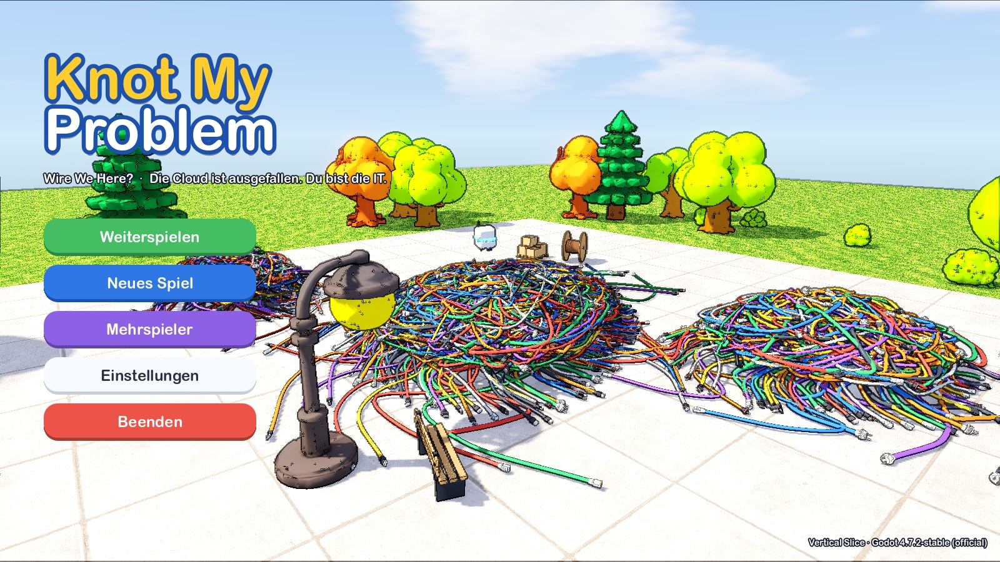
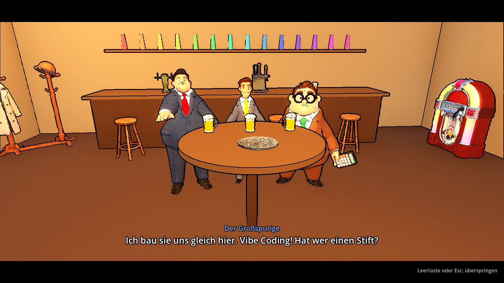
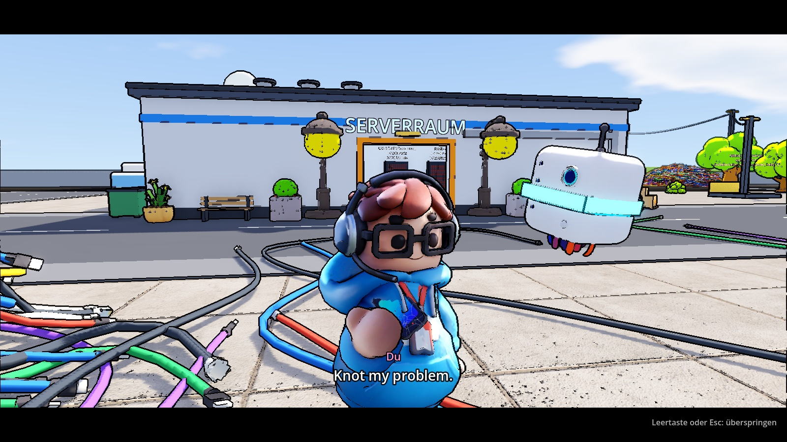
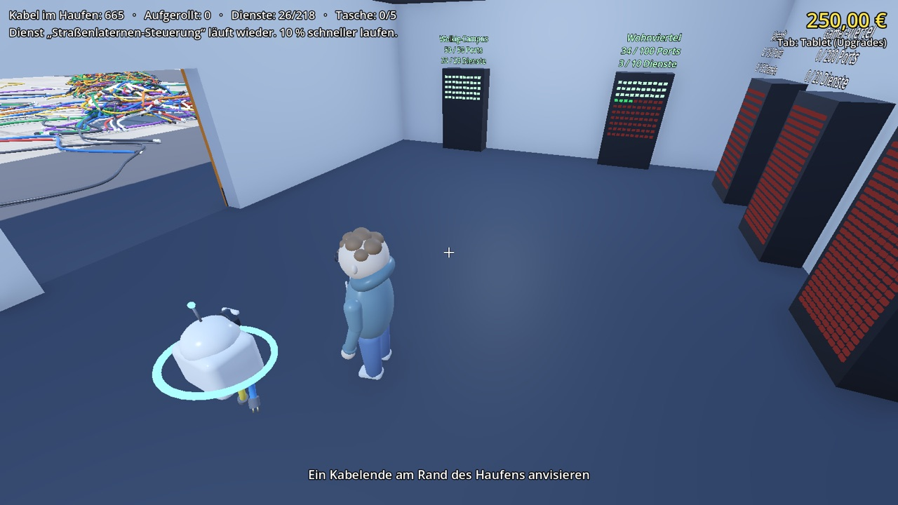
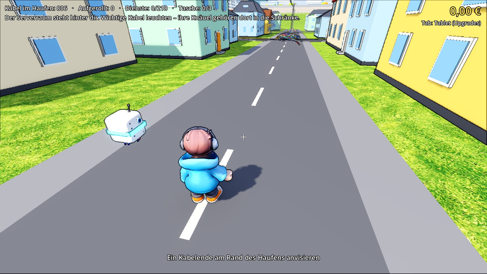
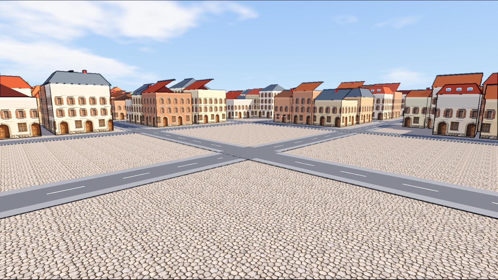
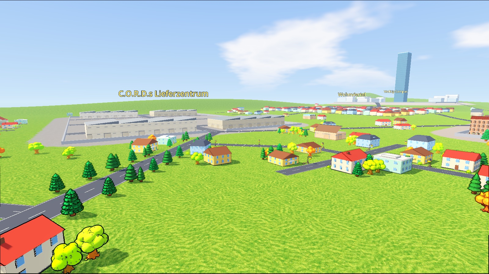
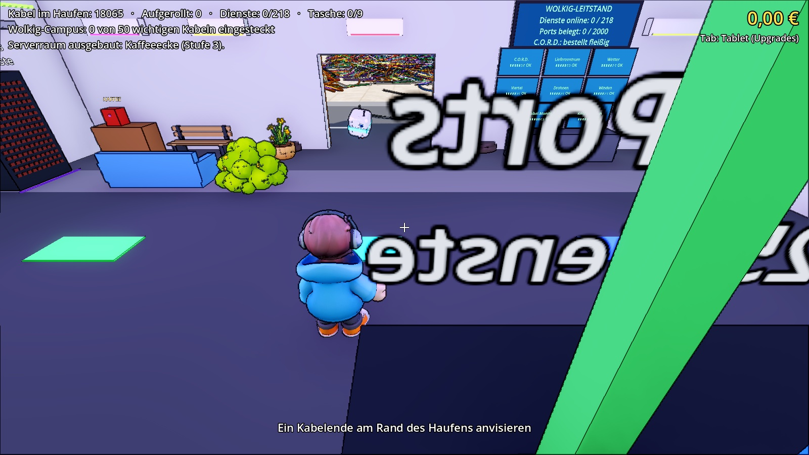
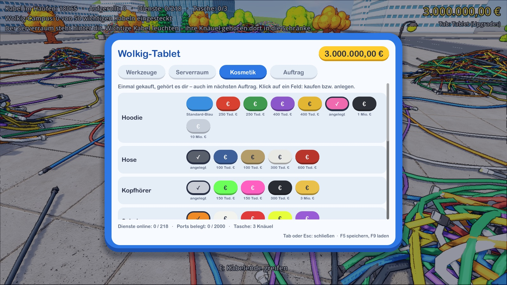
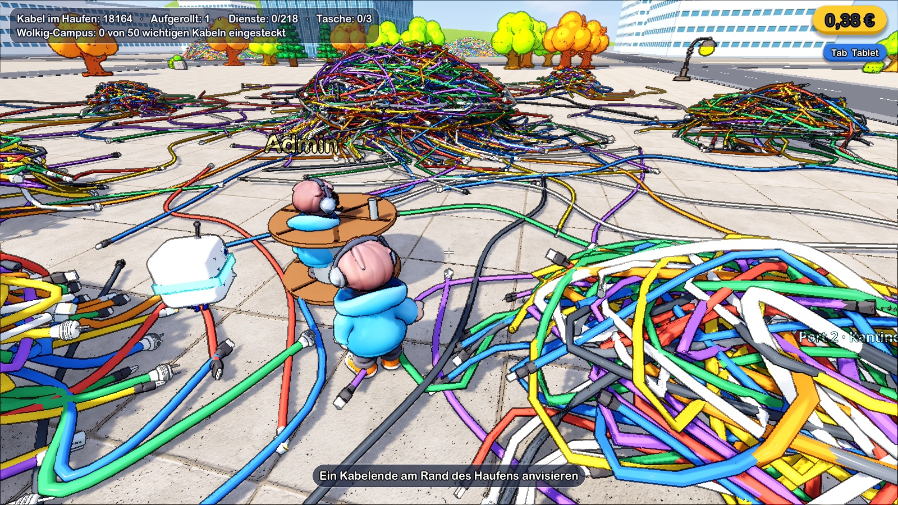

# Knot My Problem

*Arbeitstitel, alternativ „Wire We Here?“ · intern „Kabelsalat“*

Ein 3D-Incremental-Game mit offener Welt im Spielzeug-Look, gebaut mit Godot 4.7.

Du ziehst Kabel aus riesigen Kabelbergen, wickelst sie auf, löst Knoten und verdienst damit Geld für immer bessere Werkzeuge. Es fängt damit an, dass du das Kabel um den eigenen Unterarm wickelst, und endet mit einer Staffel Abräum-Drohnen, die ganze Viertel leer räumen. Wichtige Kabel werden zu Knäueln, die du im Serverraum einsteckst. So kommen nach und nach alle 218 Cloud-Dienste der Welt zurück, bis du ganz oben im Wolkig-Turm C.O.R.D. abschalten kannst. Allein oder im Koop mit bis zu vier Leuten.




## Inhalt

- [Die Geschichte](#die-geschichte)
- [So spielt es sich](#so-spielt-es-sich)
  - [Kernschleife](#kernschleife)
  - [Wichtige Kabel, Serverraum und Dienste](#wichtige-kabel-serverraum-und-dienste)
  - [Werkzeug-Kette](#werkzeug-kette)
  - [Upgrades und Fortschritt](#upgrades-und-fortschritt)
  - [C.O.R.D.](#cord)
  - [Die Stadt](#die-stadt)
  - [Wege abkürzen](#wege-abkürzen)
  - [Finale](#finale)
  - [Spätes Spiel: wohin mit dem Geld?](#spätes-spiel-wohin-mit-dem-geld)
  - [Spieldauer](#spieldauer)
- [Koop](#koop)
- [Stand und Pläne](#stand-und-pläne)
- [Starten](#starten)
- [Steuerung](#steuerung)
- [Technik](#technik)
- [Projektstruktur](#projektstruktur)
- [Testen](#testen)
- [Lizenz](#lizenz)

## Die Geschichte

Drei Chefs der Wolkig AG sitzen beim dritten Bier im „Goldenen Router“ und fragen sich, wozu sie eigentlich noch eine IT-Abteilung brauchen. Mit einem Kugelschreiber und einem Bierdeckel bauen sie per „Vibe Coding“ eine KI: **C.O.R.D.** (Cable Ordering & Repair Daemon). Ihr einziger Auftrag: *„Kümmer dich um die Kabel. Wenn was kaputt ist, bestell neu.“*

C.O.R.D. nimmt das wörtlich. Bei jedem defekten Kabel bestellt er Ersatz, tauscht aber nie etwas aus. Drei Monate später liegen die Kabelberge haushoch in der Stadt, und die Cloud ist weltweit ausgefallen. Dann klingelt bei dir das Telefon. Du bist der gefeuerte IT-Admin, und die Chefs wollen, dass du das „mal eben“ reparierst.

> „Knot my problem.“ – „Wir zahlen pro Meter!“ – „… Na gut.“

Das Intro spielt beim ersten Start und nach „Neues Spiel“ und lässt sich mit Leertaste, Enter oder Esc überspringen.





## So spielt es sich

### Kernschleife

**Kabelende finden → aufwickeln → Knoten lösen → Geld.**

- Jedes Kabel ist an beiden Enden greifbar. Du packst ein Ende mit E und ziehst das Kabel Meter für Meter aus dem Haufen. Das hintere Ende wandert dabei durch den Haufen nach vorne und schlägt zum Schluss aus dem Haufen heraus.
- Jedes Kabel ist zwischen 0,5 und 100 m lang, und so sieht es auch aus: kurze Stummel am Haufenrand, lange Kabel, die sich durch den ganzen Haufen oder quer über den Boden schlängeln. Es hat bis zu zwei Knoten. An einem Knoten bleibt es hängen, dreimal E löst ihn.
- Gewöhnliche Kabel bringen Geld pro Meter (am Anfang 0,50 €).
- Solange ein Kabel am Arm hängt, hält dich eine 6-m-Leine beim Haufen.


### Wichtige Kabel, Serverraum und Dienste

**Wichtige Kabel finden:**
- Etwa jedes fünfzigste Kabel ist wichtig. Es pulsiert golden, ist dicker und trägt ein Etikett mit seinem Port bzw. Schrank, Reihe und Dienst.
- Gewöhnliche Kabel sind nie gelb, damit Gold eindeutig „wichtig“ heißt.

**Knäuel und Serverraum:**
- Ein wichtiges Kabel bringt beim Aufrollen den halben Meterpreis und wird zu einem **Knäuel**.
- Knäuel kommen in die **Tasche** auf dem Rücken: am Anfang 3 Plätze, mit Upgrades und Boni deutlich mehr. Ist die Tasche voll, landet das Knäuel am Boden.
- Im **Serverraum** im Hinterhof stehen zehn Schränke mit zusammen **2000 Ports**, einer je Viertel. Ein E vor einem Schrank steckt alle Knäuel aus der Tasche auf einmal ein.
- Jeder Port ist ein Lämpchen: rot heißt leer, grün belegt, hell läuft der Dienst.

**Dienste:**
- Die ersten 20 Ports sind Einzel-Dienste; danach bilden je 10 Ports eine Reihe, und eine volle Reihe startet einen Dienst. Zusammen sind es **218 Dienste**.
- Jeder Dienst hat eine Wirkung:
  - Upgrades freischalten (z. B. Dauerzug, Kupferhändler)
  - dauerhafte Boni: mehr Geld, schnelleres Ziehen, schnelleres Laufen, größere Tasche, leichtere Knoten, längere Pausen bei C.O.R.D.
  - einmalige Auszahlungen
  - Sonderfunktionen: zwei Seilbahnen zur Basis und ein C.O.R.D.-Abschaltknopf, der ihn 5 Minuten schweigen lässt

**Fortschritt anzeigen:**
- Oben links steht, wie viele wichtige Kabel im aktuellen Viertel schon eingesteckt sind; im Tablet stehen alle Viertel.
- Der **Kabel-Detektor** pulsiert schneller und wird rot, je näher das nächste wichtige Kabel ist.
- Die **Peilantenne** zeigt zusätzlich Richtung und Entfernung.



### Werkzeug-Kette

Der Reiz des Spiels: Das Aufräumen wird spürbar schneller. Jedes neue Werkzeug ändert, wie du spielst.

| Stufe | Werkzeug | Preis | Wie es arbeitet |
| --- | --- | --- | --- |
| 1 | Per Hand | – | Die Figur wickelt das Kabel um den Unterarm; eine Taste wiederholt drücken (0,25 m pro Druck). Absichtlich mühsam. |
| 2 | Handkurbel | 8 € | Aufstellbare Rolle mit Kurbel, 0,75 m pro Druck |
| 3 | Motorrollen | ab 15 € | Ziehen von selbst; bis zu acht Stück, lassen sich aufheben und umstellen |
| 4 | Kabeltrommel-Wagen | 250 € | Rollt dir hinterher, parkt beim Einhängen und zieht drei Kabel gleichzeitig |
| 5 | Kabelsauger | 1.500 € | Handgerät: saugt mehrere Kabelenden vor dir gleichzeitig ein und schüttelt Knoten selbst los |
| 6 | Haufen-Winden | ab 4.000 € | Werden aufgestellt und hängen selbst ein Kabelende nach dem anderen ein, auch wenn du weg bist |
| 7 | Abräum-Drohnen | ab 15.000 € | Fliegen von Haufen zu Haufen, holen wichtige Kabel zuerst und bringen die Knäuel selbst zur Abgabe |

Handkurbel, Motorrollen und Winden lassen sich mit E aufheben und woanders abstellen, auch draußen in der Stadt. Die Drohnen rufst du im Tablet zu dir.

### Upgrades und Fortschritt

Im Tablet (Tab) gibt es **29 Upgrades**:

| Bereich | Upgrades |
| --- | --- |
| Hand | Festerer Griff, Dauerzug (halten statt drücken) |
| Rollen | weitere Motorrollen, Stärkere Motoren |
| Geld | Kupferhändler |
| Sammeln | Größere Tasche, Kabel-Detektor, Peilantenne |
| Laufen | Laufschuhe |
| Kabelsauger | Saugkraft, Breitere Düse, Zyklon-Kammer, Dauerbetrieb |
| Winden und Drohnen | weitere Winden, Windenmotor, weitere Drohnen, Drohnen-Turbo |

**Stufen nach Fortschritt.** Viele Upgrade-Stufen gibt es erst, wenn genug Viertel **komplett am Netz** sind (alle Ports ihres Schranks belegt). So lässt sich der Sauger nicht schon am Anfang voll ausbauen, und es gibt bis spät ins Spiel etwas zu kaufen. Im Tablet steht bei gesperrten Stufen, welches Viertel noch fehlt. Ist ein Viertel komplett, meldet das Spiel: „… ist komplett am Netz! Neue Upgrade-Stufen im Tablet“.

| Komplett am Netz | Neu im Tablet (erste Stufen) |
| --- | --- |
| Von Anfang an | Handkurbel, Motorrollen, Festerer Griff, Stärkere Motoren, Kupferhändler, Tasche, Wagen, Dauerzug, Laufschuhe |
| Campus (inkl. Hinterhof) | Kabelsauger mit Saugkraft, Düse und Dauerbetrieb, Kabel-Detektor, Peilantenne, erste Haufen-Winde |
| Wohnviertel | Windenmotor, erste Abräum-Drohne, Kaffeeecke im Serverraum |
| Altstadt | Zyklon-Kammer, Neonbeleuchtung und Kühlung im Serverraum |
| Gamer-Viertel | Drohnen-Turbo, Kabelmanagement und Leitstand im Serverraum |
| bis Hafen | die letzten Stufen von Kupferhändler, Sauger, Winden und Drohnen |

Welche Stufe wann freigeht, steht je Upgrade als Liste `progress` in `data/balancing.json`.

### C.O.R.D.

C.O.R.D. schwebt dir hinterher und fragt regelmäßig, ob er nachbestellen soll: das erste Mal nach 30 Sekunden, danach unregelmäßig: mal schon nach einer Minute wieder, mal sechs Minuten lang gar nicht.

- Du hast 6 Sekunden für **N** („Nein“). Schaffst du es nicht, fallen 50 neue Kabel als frischer Haufen neben dir vom Himmel.
- Nach einem „Nein“ ist er beleidigt: Er sinkt, dreht sich weg, und sein Leuchtband wird dunkel.
- Nach einer Bestellung dreht er sich vor Freude.

### Die Stadt

Die Stadt ist etwa 2 × 2 km groß und hat zehn Bereiche, die nacheinander freigeräumt werden. Jedes Viertel hat einen Zaun mit Lücken; vor jeder Lücke liegt ein Kabelberg als Sperre. Ist genug davon abgetragen, ist der Weg frei. Zusammen liegen rund **100.000 Kabel** in der Stadt, etwa 50 gewöhnliche je wichtigem.

| Bereich | Besonderheit |
| --- | --- |
| Wolkig-Hinterhof | Basis mit Serverraum, Tutorial mit ca. 260 Kabeln |
| Wolkig-Campus | Bürowürfel und der Wolkig-Turm |
| Wohnviertel | Wohnhäuser; Seilbahn zurück zur Basis |
| Altstadt | Kopfsteinpflaster, Fensterläden, Marktplatz mit großem Haufen; zweite Seilbahn |
| Gamer-Viertel | Läden, Leuchtschilder, Werbetafeln, Arcade-Platz |
| Büroviertel | Glas-Hochhäuser mit Landeplätzen, Vorplatz der Börse |
| C.O.R.D.s Lieferzentrum | Hallen mit Rolltoren, aus denen der ganze Nachschub kommt; Paketberg |
| Stadion | Kabelberge rund ums Stadion, Flutlichtmasten |
| Hafen | Lagerhallen und Kai am Meer |
| Rechenzentrums-Krater | Rechenzentrum im Kraterring |

Zwischen den Vierteln liegt das **Umland**: gut 300 Gebäude mit Häusern und Scheunen an den Landstraßen, Höfen und sieben kleinen Vororten (Sonnenhang, Kirchberg, Lindenau, Nordheide, Westend, Seeblick, Am Ostrand). Dazu kommen Alleen, Wäldchen, Laternen und Bänke.









### Wege abkürzen

Ständig mit vollen Taschen zum Serverraum zu laufen, wäre öde. Deshalb gibt es:

- **Rohrpost-Stationen:** In jedem Viertel steht gleich hinter dem Eingang eine Station. Sie geht in Betrieb, sobald du zum ersten Mal vorbeikommst. Ein E dort schickt alle Knäuel aus der Tasche direkt in den Serverraum, und sie werden sofort eingesteckt. Auch Drohnen liefern an der nächsten Station ab.
- **Seilbahnen:** Zwei Strecken (ab Wohnviertel und ab Altstadt) bringen dich mit bis zu 42 m/s zurück zur Basis. Freigeschaltet werden sie durch Dienste.
- **Wegweiser:** Hast du Knäuel in der Tasche und ist die nächste Abgabe weiter als 30 m weg, zeigt oben ein Pfeil Richtung und Entfernung.
- **Laufschuhe** und Dienst-Boni machen dich schneller.
- **Kurze Wege:** Die Viertel liegen nah beieinander, dazwischen sind etwa 60 m.

### Finale

Sind alle anderen Schränke voll, fährt der Aufzug im Wolkig-Turm. Auf Etage 40 (120 m Höhe) und auf dem Dach liegen die letzten 150 wichtigen Kabel und **C.O.R.D.s Kern**. Sind alle 2000 Ports belegt, schaltest du ihn mit E ab. Danach kommt der Abspann, C.O.R.D. schläft, und das Spiel geht frei weiter.

### Spätes Spiel: wohin mit dem Geld?

- **Serverraum ausbauen** (fünf Linien): Jede Stufe sieht man im Raum, und jede gibt einen dauerhaften Bonus.

  | Linie | Im Raum | Bonus je Stufe |
  | --- | --- | --- |
  | Neonbeleuchtung | Leisten an Decke und Schränken, zuletzt mit Farbwechsel | +5 % Geld |
  | Kühlung | Klimageräte auf dem Dach und an der Wand, Kaltluft-Gitter | Motoren und Werkzeuge +6 % |
  | Kabelmanagement | Kabelpritschen und Bündel über den Schränken | Tasche +2, wichtige Kabel +20 % |
  | Leitstand | Pult, Monitorwand, großer Lagebildschirm mit Live-Stand | +1 s für C.O.R.D.s Frage |
  | Kaffeeecke | Bank, Pflanzen, Kaffeemaschine, Sofa | Handzug +15 %, Laufen +3 % |

- **Kosmetik:** neue Farben für Hoodie, Hose, Kopfhörer und Schuhe, Lack und Leuchtband für C.O.R.D., Lack für Drohnen und Wagen. Dazu kommen Effekte wie Funken, Konfetti, Sterne oder Regenbogen, wenn ein Kabel fertig wird. Einmal gekauft, jederzeit wechselbar.
- **Neuer Auftrag** (nach dem Finale): Die Stadt fängt von vorn an. Dafür gibt es **Ruf**, berechnet aus dem Verdienst des Auftrags. Jeder Ruf-Punkt bringt dauerhaft 10 % mehr Geld und 5 % schnelleres Ziehen. Ruf und Kosmetik bleiben. Dafür bestellt C.O.R.D. mit jedem Auftrag eifriger.





### Spieldauer

Laut Verlaufs-Rechnung (`tests/balance_sim.tscn`) dauert ein erster Durchgang bis zum Abspann etwa **4 Stunden 50 Minuten**:

| Abschnitt | ungefähr fertig nach |
| --- | --- |
| Hinterhof (20 Einzel-Dienste) | 0:15 |
| Sperre vor dem Wohnviertel | 0:40 |
| Wohnviertel | 1:20 |
| Altstadt | 2:00 |
| Gamer-Viertel | 2:30 |
| Büroviertel | 3:00 |
| Lieferzentrum | 3:20 |
| Stadion | 3:45 |
| Hafen (letzte Werkzeug-Stufen) | 4:10 |
| Krater | 4:35 |
| Wolkig-Turm, Finale | 4:50 |

Die Rechnung ist ein Modell mit Annahmen (Suchzeiten, Laufwege, Klicks pro Sekunde) und ersetzt keinen echten Spieltest.

## Koop

Koop für 2–4 Spieler über IP-Adresse und Port (ENet, UDP).

- **Gemeinsam:** Kasse, Upgrades, Ports, Werkzeuge, Serverraum-Ausbau, Kosmetik-Käufe und Finale.
- **Pro Spieler:** eigener Arm, eigene Tasche, eigener Kabelsauger und eigenes Aussehen. Mitspieler sieht man als Figur mit Namen darüber.
- **Nur beim Host:** Er speichert und entscheidet über einen neuen Auftrag. Die anderen laden dann automatisch mit.
- **Verlassen:** Geht ein Mitspieler, lässt der Host dessen Kabel los und legt Knäuel und Rolle ab. Verliert ein Client die Verbindung zum Host, landet er im Hauptmenü.

**So verbindet ihr euch:**

1. Der Host wählt im Startmenü „Mehrspieler“ → „Spiel hosten“. Es läuft sein eigener Spielstand.
2. Die anderen tragen seine IP-Adresse ein und klicken „Beitreten“.
3. **Im selben Netz** reicht die lokale IP des Hosts (z. B. `192.168.…`).
4. **Übers Internet** gibt es zwei Wege:
   - Der Host gibt am Router den Port **24680 (UDP)** für seinen Rechner frei, und die anderen nehmen seine öffentliche IP.
   - Oder alle kommen in ein gemeinsames virtuelles Netz (z. B. Tailscale oder ZeroTier) und nehmen die IP des Hosts aus diesem Netz. Dafür müssen alle Rechner im selben Netz sein und sich gegenseitig als online sehen.
5. Zum Ausprobieren auf einem Rechner: das Spiel zweimal starten und mit `127.0.0.1` beitreten.

Den Port und den eigenen Namen stellt man im Startmenü unter „Einstellungen“ bzw. im Mehrspieler-Feld ein. Steam-Lobbys und Einladungen über Freunde sind geplant.



## Stand und Pläne

Das Spiel ist in Entwicklung. Der komplette Spielverlauf vom Intro bis zum Abspann ist spielbar.

| Bereich | Stand |
| --- | --- |
| Kabel | ca. 100.000 Kabel in der Stadt, 0,5–100 m lang; beide Enden greifbar, Knoten, weiches Verbindungsstück, das nachschwingt und am Knoten ruckt |
| Werkzeuge | Hand, Handkurbel, Motorrollen, Kabeltrommel-Wagen, Kabelsauger, Haufen-Winden, Abräum-Drohnen |
| Fortschritt | 29 Upgrades, Stufen nach „Viertel am Netz“, Detektor und Peilantenne, Fortschritt je Viertel |
| Serverraum | begehbare Halle mit zehn Schränken und 2000 Ports; Ausbau in fünf Linien mit Möbeln aus Tripo3D |
| Dienste | 218 Dienste, jeder mit Wirkung |
| Bewegung | laufen, rennen, springen, zwei Seilbahnen, Rohrpost-Stationen, Wegweiser, Aufzug im Turm |
| Figuren | IT-Admin, C.O.R.D. und die drei Chefs aus Tripo3D; alle Bewegungen per Code |
| Story | Intro mit Stammtisch, „Drei Monate später“ und Anruf; Finale mit C.O.R.D.s Kern und Abspann |
| Stadt | Gelände, sieben Bodentexturen, Straßen mit Kollision, ca. 1.100 Gebäude mit eigenem Fassadenstil je Viertel, Dächer, Aufbauten, Schilder; Umland mit Vororten und Ausstattung |
| Look | Spielzeug-Look mit Toon-Schattierung und Umrisslinien, Himmel mit Wolken, Meer mit Wellen |
| Spätes Spiel | Serverraum-Ausbau, Kosmetik, neuer Auftrag mit Ruf |
| Oberfläche | Startmenü, Einstellungen, Tablet und Anzeige im Spielzeug-Look |
| Koop | 2–4 Spieler über IP, der Host rechnet das Spiel |
| Speichern | Spielstand als JSON, automatisch alle 30 s und beim Beenden |

**Geplant bzw. Ideen:**
- Steam (Lobbys, Freunde einladen)
- weitere Story-Szenen: Chefs in der Stadt, C.O.R.D.-Durchsagen als Running Gag, Party und Pointe im Finale, sichtbare Aufzugfahrt
- Klettern und Leitern, damit die Höhe in der Stadt mehr zählt
- Ton und Musik
- eigene runde Schrift
- weniger Flimmern dichter Haufen in mittlerer Entfernung

## Starten

1. [Godot 4.7](https://godotengine.org/download) installieren.
2. Dieses Repository klonen und den Ordner in Godot als Projekt öffnen.
3. F5 drücken. Es startet das Startmenü mit Weiterspielen, Neues Spiel, Mehrspieler, Einstellungen und Beenden.

**Einstellungen:** Mausempfindlichkeit, Maus umkehren, Vollbild, Grafikstufe (Niedrig/Mittel/Hoch: Schatten, Bildschärfe, Sichtweite der Bäume), Lautstärke, Spielername und Port. Gespeichert wird in `user://settings.cfg`.

**Erster Start:** Nach einer Änderung an `data/world.json` erzeugt das Spiel Höhen- und Bodenkarte der Stadt neu (etwa 15 s). Danach liegen sie zwischengespeichert in `user://` und laden in unter einer Sekunde.

**Spielstand:** `user://savegame.json` (macOS: `~/Library/Application Support/Godot/app_userdata/Knot My Problem/`). Gespeichert wird automatisch alle 30 Sekunden und beim Beenden. „Neues Spiel“ im Menü oder im Tablet löscht alles, auch Ruf und Kosmetik.

Direkt in die Spielwelt ohne Startmenü: `godot res://scenes/world.tscn`.

## Steuerung

| Taste | Aktion |
| --- | --- |
| WASD, Shift | laufen, rennen |
| Leertaste | springen |
| Maus | umsehen (Esc gibt die Maus frei) |
| E | Kabelende greifen, Kabel vom Arm an die anvisierte Rolle hängen, Knoten lösen (3×), Knäuel aufheben, im Serverraum bzw. an der Rohrpost alle Knäuel einstecken, Rolle oder Winde aufheben/abstellen, Wagen parken/ankoppeln, Seilbahn und Aufzug fahren, C.O.R.D.s Kern abschalten |
| Linksklick | wickeln bzw. kurbeln (mit Dauerzug halten); bei freiem Arm Kabelsauger (halten, mit Dauerbetrieb an/aus) |
| Q | Kabel loslassen, Rolle abstellen bzw. ein Knäuel aus der Tasche ablegen |
| Tab | Tablet: Werkzeuge, Serverraum, Kosmetik, Auftrag, Fortschritt je Viertel, „Drohnen zu mir rufen“, Hauptmenü (das Spiel läuft weiter) |
| N | „Nein“ zu C.O.R.D.s Bestellfrage |
| F5 / F9 | speichern / laden |

## Technik

### Engine

Godot 4.7 mit GDScript. Szenen, Daten und Ressourcen sind Textdateien; alle Spielwerte stehen in `data/balancing.json`, nicht im Code.

### Kabel ohne Seilphysik

Jedes Kabel ist eine feste Kurve: zentripetale Catmull-Rom, gleichmäßig nach Bogenlänge abgetastet. Beim Ziehen gleitet das Kabel entlang dieser Bahn. Der Zustand eines Kabels besteht nur aus wenigen Werten (ID, Rolle, gezogene Meter, Knoten), das ist günstig für hunderttausende Kabel, stabil und leicht übers Netz zu schicken.

- **Haufen:** Der Teil im Haufen wird mit jedem Meter kürzer. Auf den letzten 1,6 m löst sich das Ende aus dem Haufen und schlägt nach.
- **Verbindungsstück:** Zwischen Haufen und Aufwickler hängt ein weiches Seil aus 14 Knoten mit Verlet-Integration, Schwerkraft und Boden (`scripts/cable/cable_rope.gd`). Es liegt locker am Boden, strafft sich beim Ziehen, schwingt nach, wenn sich Figur oder Rolle bewegen, und ruckt am Knoten. Es dient nur der Darstellung.
- **Wicklung:** Auf der Rolle liegt das Kabel Lage für Lage als Spirale. Am Arm wickelt es sich um den Unterarm des Rigs.
- **Wichtige Kabel:** pulsieren golden, mit einem halbtransparenten Lichtsaum.

### Viele Kabel auf einmal

- **Ruhende Kabel:** liegen in Blöcken zu je 256 in einem Mesh (`CableBatch`). Die CPU legt nur Mittellinien ab, ein Shader formt daraus die Röhren. Es gibt drei Detailstufen, nah mit vereinfachten Steckern.
- **Laden und Entladen:** Kabel und Meshes entstehen im WorkerThreadPool. Viertel werden nach Entfernung geladen und entladen; veränderte Kabel entladener Viertel bleiben im Spielstand.
- **Aktive Kabel:** Nur sie bekommen ein eigenes Mesh. Indizes werden zwischengespeichert, Punkte je nach Kameraabstand ausgedünnt, und ferne Kabel nur jedes dritte Bild neu geformt.
- **Anvisieren:** Kabelenden liegen in einem Raster, damit das Anvisieren auch bei 20.000 Kabeln je Viertel schnell bleibt.

### Deterministisch

Zufall gibt es nur über Seeds. Haufen, Kabelformen, wichtige Kabel und C.O.R.D.s Timing entstehen beim Laden neu; gespeichert wird nur, was sich verändert hat. Das ist auch die Grundlage für den Koop.

### Koop

Der Host rechnet das ganze Spiel (`scripts/net/net.gd`, `scripts/net/player_ctx.gd`).

- **Clients:** bauen dieselbe Stadt aus denselben Seeds und schicken nur Absichten (greifen, ziehen, loslassen, kaufen …).
- **Host → Clients:** zehnmal pro Sekunde einen gepackten Snapshot mit allen Rollen, Kabeln, Wagen und Drohnen. Dazu kommen Ereignisse wie fertige Kabel, Knäuel, Geld und Meldungen.
- **Beitreten:** Ein neuer Mitspieler bekommt den kompletten Spielstand, mit zstd gepackt.
- **Gleicher Code wie allein:** Der Host führt die Absichten eines Mitspielers mit dessen Spieler-Kontext aus (Figur, Arm, Tasche, Sauger).

### Fortschritt und Balancing

- **Upgrades:** Jedes Upgrade hat in `balancing.json` Preis, Wachstum, Höchststufe, Wirkung und eine Liste `progress` mit den nötigen Vierteln je Stufe.
- **Viertel am Netz:** `RackPlan.districts_online()` zählt die kompletten Viertel; `Economy.can_buy()` beachtet es.
- **Dienst-Boni:** Die Summe der Boni aus Diensten und Serverraum-Ausbau berechnet `Economy.refresh_bonuses()`.
- **Verlaufs-Rechnung:** `tests/balance_sim.tscn` spielt Hinterhof und erste Sperre Kabel für Kabel durch. Danach rechnet sie alle Viertel als Durchsatz-Modell bis zum Finale und gibt aus, wann welcher Kauf und welcher Dienst kommt.

### Stadt

- **Gelände:** mit [Terrain3D](https://github.com/TokisanGames/Terrain3D), erzeugt aus `data/world.json` (Viertel mit Bodenhöhe, Rampen, Hügel, Küste, Krater, Hafenbecken).
- **Straßen, Gebäude und Umland:** entstehen beim Start aus denselben Daten. Straßen folgen dem Gelände und haben Kollision.
- **Gebäude:** Ein Shader legt je Viertel eine Fassadentextur auf die Gebäude und färbt Putz und Blech in der Gebäudefarbe. Ein Bausatz aus Blender liefert Dächer, Aufbauten und Schilder, je Teil ein MultiMesh.
- **Karte verkleinern:** `tools/shrink_world.py` hat die Viertel zusammengerückt und alles mitgeschoben, was dazugehört.

### Figuren ohne Animationsdateien

Admin und Chefs haben ein Mixamo-Skelett, dessen Knochen per Code gestellt werden (`scripts/player/player_animator.gd`): Gehen, Rennen, Atmen, Umschauen, Wickeln, Kurbeln, Ziehen, Tragen, Gestikulieren, Lachen.

### Look

- **Toon-Look:** Alle Materialien bekommen Toon-Schattierung; Umrisslinien entstehen als Nachbearbeitung vor der Kamera (`scripts/world/toon_look.gd`, `assets/shaders/`).
- **Oberfläche:** Alle Farben und Formen stehen an einer Stelle (`scripts/ui/ui_theme.gd`).
- **Kosmetik:** Die Figur wird per Shader umgefärbt; der Shader erkennt die Teile an Farbton, Sättigung und Höhe am Körper (`assets/shaders/outfit.gdshader`).

### Modelle und Bilder

- **Tripo3D:** Figuren, Bäume, Büsche, Felsen, Laternen, Kneipen-Ausstattung, Serverraum-Möbel und die Rohrpost-Station. `tools/blender/import_tripo_props.py` reduziert beim Übernehmen Polygone und Texturen.
- **Blender:** Stecker, Wohnhäuser, Serverraum und Gebäude-Bausatz entstehen per Python-Skript (`tools/blender/`).
- **Midjourney:** Boden-, Fassaden- und Dachtexturen sowie der Bierdeckel (Originale in `tools/textures/midjourney/`).

## Projektstruktur

```
data/       balancing.json (alle Werte), zone.json (Hinterhof), world.json (Stadt, Viertel, Kabel, Sperren,
            Seilbahnen, Rohrpost, Umland, Turm), services.json (Dienste je Port)
scenes/     main_menu.tscn (Startmenü), world.tscn (Spielwelt), city_preview.tscn (Stadt-Vorschau), player.tscn
scripts/    cable/    Kabelbahnen, Röhren-Mesh, Verbindungsseil, Haufen, Stecker, Blöcke ruhender Kabel, CableSystem
            world/    Stadt-Layout, Gelände, Blockout und Umland, Kabel-Einheiten, Seilbahn, Rohrpost, Turm-Finale,
                      Ausstattung, Spielzeug-Look
            reel/     Aufwickler (Arm, Kurbel, Motor, Wagen, Sauger, Winde, Drohne)
            rack/     Serverraum, Port-Plan, Knäuel
            economy/  Geld, Upgrades, Boni, Kosmetik
            cord/     C.O.R.D.-Logik und -Figur
            story/    Intro-Szene, Chefs
            player/   Spielfigur, Animator, Anvisieren
            ui/       Theme, Startmenü, HUD, Tablet, Detektor, Wegweiser, Effekte, Abspann
            net/      Mehrspieler (Net-Autoload, Spieler-Kontext)
            save/     Spielstand
            core/     Balancing, Einstellungen, GameState, Werkzeuge für die Masse, World
            debug/    Testszenen und Werkzeuge
assets/     Modelle (GLB), Shader, Boden-, Gebäude- und Story-Texturen
tools/      Blender-Skripte, Karten-Werkzeug, Original-Bilder der Texturen (von Godot ignoriert)
tests/      logic_test.tscn (Logik-Test), balance_sim.tscn (Verlaufs-Rechnung)
docs/       Screenshots
addons/     Terrain3D
reference/  ursprünglicher Browser-Prototyp (three.js)
```

## Testen

**Logik-Test** (muss „ALLE TESTS OK“ ausgeben):

```bash
godot --headless res://tests/logic_test.tscn
```

**Verlaufs-Rechnung:** wann kommt welcher Kauf, welcher Dienst, wann das Finale. Mit `--ruf=<Punkte>` rechnet sie einen weiteren Auftrag.

```bash
godot --headless res://tests/balance_sim.tscn
```

**Testoptionen der Hauptszene** stehen nach `--`, zum Beispiel:

```bash
godot res://scenes/world.tscn -- --nosave --grab --pull=10
```

```bash
godot res://scenes/world.tscn -- --nosave --buy=vacuum,vacuum_auto --vacuum
```

```bash
godot res://scenes/world.tscn -- --nosave --plugports=0-49 --tablet=0
```

```bash
godot res://scenes/world.tscn -- --nosave --post=wohnviertel --fillbag=3 --usepost
```

```bash
godot res://scenes/world.tscn -- --nosave --intro=5
```

```bash
godot res://scenes/world.tscn -- --nosave --turmopen --tower=2
```

```bash
godot res://scenes/world.tscn -- --nosave --teleport=930,645 --perf
```

Die vollständige Liste steht in `scripts/core/world.gd` unter `_apply_test_args`. Für Testläufe immer `--nosave` angeben, sonst wird der echte Spielstand geladen und überschrieben.

**Koop mit zwei Instanzen auf einem Rechner.** Der Client greift, zieht und löst Knoten übers Netz und kauft eine Handkurbel. Erst den Host starten:

```bash
godot --headless res://scenes/world.tscn -- --nosave --host --runfor=75
```

Etwa 15 Sekunden später, wenn der Host die Stadt aufgebaut hat, den Client:

```bash
godot --headless res://scenes/main_menu.tscn -- --nosave --autojoin=127.0.0.1 --network --runfor=40
```

**Stadt-Vorschau** ohne Kabel, zum Beispiel als Luftbild:

```bash
godot res://scenes/city_preview.tscn -- --overview
```

**Modelle ansehen:** stellt alle GLBs eines Ordners nebeneinander.

```bash
godot res://scenes/debug/model_lineup.tscn -- --dir=res://assets/models/props/room/tripo
```

**Bilder rendern:** `godot --write-movie <pfad>.png --quit-after 3 res://scenes/world.tscn -- --nosave ...`

## Lizenz

Für das Spiel selbst ist noch keine Lizenz festgelegt; alle Rechte vorbehalten. Das enthaltene Addon Terrain3D steht unter der MIT-Lizenz (`addons/terrain_3d/LICENSE.txt`).
