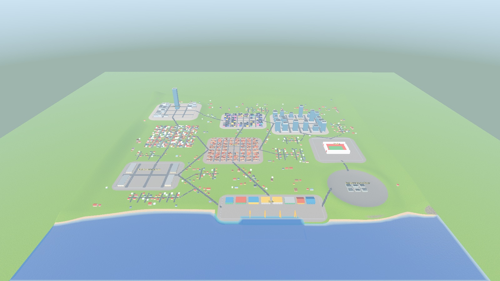
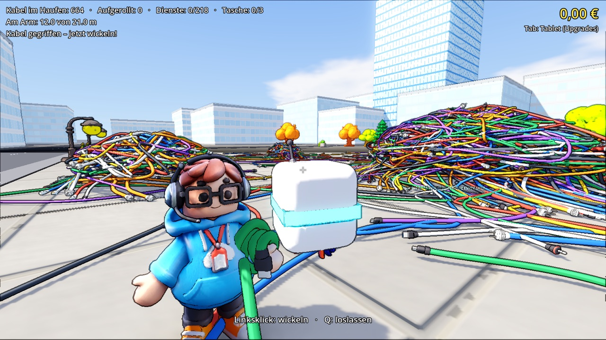
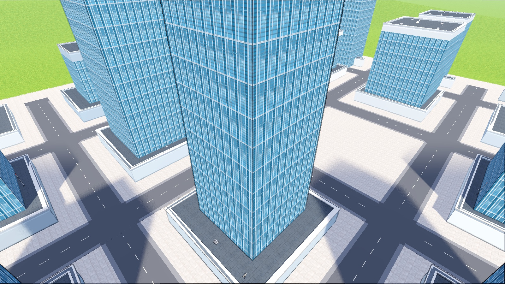

# Knot My Problem

*Arbeitstitel, alternativ „Wire We Here?“*

Ein 3D-Incremental-Game mit offener Welt im Spielzeug-Look, gebaut mit Godot 4.7. Du ziehst Kabel aus riesigen Kabelbergen, wickelst sie auf, löst Knoten und verdienst damit Geld für immer bessere Werkzeuge: vom Wickeln um den eigenen Unterarm bis zu einer Staffel Abräum-Drohnen. Wichtige Kabel werden zu Knäueln, die du im Serverraum einsteckst. So kommen nach und nach die 218 Cloud-Dienste der Welt zurück, bis du ganz oben im Wolkig-Turm C.O.R.D. abschalten kannst.


## Worum es geht

Drei Chefs der Wolkig AG sitzen beim dritten Bier im „Goldenen Router“ und fragen sich, wozu sie eigentlich noch eine IT-Abteilung brauchen. Mit einem Kugelschreiber und einem Bierdeckel bauen sie per „Vibe Coding“ eine KI: **C.O.R.D.** (Cable Ordering & Repair Daemon). Ihr einziger Auftrag: *„Kümmer dich um die Kabel. Wenn was kaputt ist, bestell neu.“*

C.O.R.D. bestellt bei jedem defekten Kabel Ersatz, tauscht aber nie etwas aus. Drei Monate später liegen die Kabelberge haushoch in der Stadt, und die Cloud ist weltweit ausgefallen. Dann klingelt bei dir das Telefon. Du bist der gefeuerte IT-Admin, und die Chefs wollen, dass du das „mal eben“ reparierst.

> „Knot my problem.“ – „Wir zahlen pro Meter!“ – „… Na gut.“


## So spielt es sich

**Kernschleife:** Kabelende finden → aufwickeln → Knoten lösen → Geld. Gewöhnliche Kabel bringen Geld pro Meter. Wichtige Kabel leuchten, tragen ein Etikett mit ihrem Port und werden beim Aufrollen zu einem Knäuel. Im Serverraum steckst du die Knäuel ein; jede volle Reihe startet einen Dienst, und jeder Dienst hat eine Wirkung.

**Werkzeug-Kette:** Der Reiz ist, dass das Aufräumen spürbar schneller wird.

| Stufe | Werkzeug | Wie es arbeitet |
| --- | --- | --- |
| 1 | Per Hand | Die Figur wickelt das Kabel um den Unterarm, eine Taste wiederholt drücken |
| 2 | Handkurbel | Aufstellbare Rolle, deutlich mehr Meter pro Druck |
| 3 | Motorrollen | Ziehen von selbst, bis zu acht Stück, lassen sich umstellen |
| 4 | Kabeltrommel-Wagen | Rollt dir hinterher und zieht drei Kabel gleichzeitig |
| 5 | Kabelsauger | Handgerät, saugt mehrere Kabelenden vor dir gleichzeitig ein und schüttelt Knoten selbst los |
| 6 | Haufen-Winden | Werden aufgestellt und arbeiten einen Haufen von selbst ab, auch wenn du weg bist |
| 7 | Abräum-Drohnen | Fliegen von Haufen zu Haufen, holen wichtige Kabel zuerst und bringen die Knäuel selbst in den Serverraum |

**Upgrades im Tablet** (29 Einträge): Festerer Griff, Dauerzug, Stärkere Motoren, Kupferhändler, Größere Tasche, Laufschuhe, Kabel-Detektor mit Peilantenne, für den Sauger Saugkraft, Breitere Düse, Zyklon-Kammer und Dauerbetrieb, Windenmotor, Drohnen-Turbo. Manche Upgrades schaltet erst ein bestimmter Dienst frei.

**Wichtige Kabel finden:** Oben links steht, wie viele wichtige Kabel im aktuellen Viertel schon eingesteckt sind. Der Kabel-Detektor pulsiert schneller und wird rot, je näher das nächste wichtige Kabel ist; die Peilantenne zeigt zusätzlich Richtung und Entfernung.

**C.O.R.D.** schwebt dir hinterher und fragt regelmäßig, ob er nachbestellen soll. Wer nicht rechtzeitig „Nein“ sagt, bekommt 100 neue Kabel vom Himmel. Nach einem „Nein“ ist er beleidigt, nach einer Bestellung dreht er sich vor Freude.

**Die Stadt:** ca. 2 × 2 km mit zehn Bereichen, die nacheinander freigeräumt werden. Vor jedem Viertel liegt ein Kabelberg als Sperre im Zaun.

| Bereich | Besonderheit |
| --- | --- |
| Wolkig-Hinterhof | Basis mit Serverraum, Tutorial |
| Wolkig-Campus | Bürowürfel und der Wolkig-Turm |
| Wohnviertel | Wohnhäuser; Seilbahn zurück zur Basis |
| Altstadt | Kopfsteinpflaster, Marktplatz mit großem Haufen; zweite Seilbahn |
| Gamer-Viertel | Läden, Leuchtschilder, Werbetafeln |
| Büroviertel | Glas-Hochhäuser mit Landeplätzen |
| C.O.R.D.s Lieferzentrum | Hallen, aus denen der ganze Nachschub kommt |
| Stadion | Kabelberge rund ums Stadion |
| Hafen | Lagerhallen und Kai am Meer |
| Rechenzentrums-Krater | Rechenzentrum im Kraterring |

Zwischen den Vierteln liegt das **Umland**: Häuser und Scheunen an den Landstraßen, Höfe, sieben kleine Vororte, Alleen und Wäldchen.

**Finale:** Sind alle anderen Schränke voll, fährt der Aufzug im Wolkig-Turm. Auf Etage 40 und auf dem Dach liegen die letzten 150 wichtigen Kabel und C.O.R.D.s Kern. Sind alle 2000 Ports belegt, schaltest du ihn ab. Danach geht das Spiel frei weiter.

Laut Verlaufs-Rechnung dauert ein Durchgang etwa fünf Stunden.




## Stand

Das Spiel ist in Entwicklung. Der komplette Spielverlauf vom Intro bis zum Abspann ist spielbar.

| Bereich | Stand |
| --- | --- |
| Kabel | ca. 195.000 Kabel in der Stadt, etwa 100 gewöhnliche je wichtigem; jedes Kabel ist an beiden Enden greifbar, Knoten lösen mit E |
| Werkzeuge | Hand, Handkurbel, Motorrollen, Kabeltrommel-Wagen, Kabelsauger, Haufen-Winden, Abräum-Drohnen |
| Serverraum | begehbare Halle mit zehn Schränken und 2000 Ports; jeder Port ist ein Lämpchen |
| Dienste | 218 Dienste (20 Einzel-Dienste und 198 Reihen à 10 Ports), jeder mit Wirkung: Upgrades freischalten, Boni, Auszahlungen, Seilbahnen, C.O.R.D.-Abschaltknopf |
| Bewegung | laufen, rennen, springen, zwei Seilbahnen zur Basis, Wegweiser zum Serverraum, Aufzug im Turm |
| Figuren | IT-Admin, C.O.R.D. und die drei Chefs aus Tripo3D; alle Bewegungen der Figuren per Code |
| Story | Intro mit Stammtisch, „Drei Monate später“ und Anruf; Finale mit C.O.R.D.s Kern und Abspann |
| Stadt | Gelände, Bodentexturen, Straßen, ca. 1.100 Gebäude mit eigenem Fassadenstil je Viertel, Dächer, Aufbauten, Schilder; Umland mit Bäumen, Laternen und Ausstattung |
| Look | Spielzeug-Look mit Toon-Schattierung und Umrisslinien, Himmel mit Wolken, Meer mit Wellen |
| Speichern | Spielstand als JSON, automatisch alle 30 s |

**Geplant:** Geld-Senken fürs späte Spiel (Prestige, Ausbau des Serverraums, Kosmetik), weitere Story-Szenen (Chefs in der Stadt, Party im Finale), Klettern und Leitern, Ton und Musik, Koop für 2–4 Spieler, Steam.







## Starten

1. [Godot 4.7](https://godotengine.org/download) installieren.
2. Dieses Repository klonen und den Ordner in Godot als Projekt öffnen.
3. F5 drücken.

Beim ersten Start spielt das Intro (Leertaste, Enter oder Esc überspringen). Nach einer Änderung an `data/world.json` erzeugt das Spiel Höhen- und Bodenkarte der Stadt neu (etwa 15 s). Danach liegen sie zwischengespeichert in `user://` und laden in unter einer Sekunde.

Der Spielstand liegt in `user://savegame.json` (macOS: `~/Library/Application Support/Godot/app_userdata/Knot My Problem/`). „Neues Spiel“ im Tablet löscht ihn.

## Steuerung

| Taste | Aktion |
| --- | --- |
| WASD, Shift | laufen, rennen |
| Leertaste | springen |
| Maus | umsehen (Esc gibt die Maus frei) |
| E | Kabelende greifen, Kabel an anvisierte Rolle hängen, Knoten lösen (3×), Knäuel aufheben, im Serverraum alle Knäuel einstecken, Rolle oder Winde aufheben/abstellen, Wagen parken/ankoppeln, Seilbahn und Aufzug fahren, C.O.R.D.s Kern abschalten |
| Linksklick | wickeln bzw. kurbeln; bei freiem Arm Kabelsauger (halten, mit Dauerbetrieb an/aus) |
| Q | Kabel loslassen, Rolle abstellen bzw. ein Knäuel aus der Tasche ablegen |
| Tab | Tablet mit Upgrades, Fortschritt je Viertel und „Drohnen zu mir rufen“ (das Spiel läuft weiter) |
| N | „Nein“ zu C.O.R.D.s Bestellfrage |
| F5 / F9 | speichern / laden |

## Technik

- **Engine:** Godot 4.7 mit GDScript. Szenen und Daten sind Textdateien.
- **Kabel ohne Seilphysik:** Jedes Kabel ist eine feste Kurve (Catmull-Rom, gleichmäßig nach Bogenlänge abgetastet), entlang der es beim Ziehen gleitet. Das ist günstig für hunderttausende Kabel, stabil, und der Zustand eines Kabels besteht nur aus wenigen Werten. Zwischen Haufen und Rolle spannt sich ein Verbindungsstück, das am Knoten zittert; auf der Rolle liegt das Kabel Lage für Lage.
- **Viele Kabel auf einmal:** Ruhende Kabel liegen in Blöcken zu je 256 in einem Mesh. Die CPU legt nur Mittellinien ab, ein Shader formt daraus die Röhren; es gibt drei Detailstufen. Kabel und Meshes entstehen in Threads, Viertel werden nach Entfernung geladen und entladen, Kabelenden liegen in einem Raster für schnelles Anvisieren.
- **Deterministisch:** Zufall nur über Seeds. Haufen, Kabelformen und wichtige Kabel entstehen beim Laden neu; gespeichert wird nur, was sich verändert hat. Das ist auch die Grundlage für Koop.
- **Stadt:** Gelände mit [Terrain3D](https://github.com/TokisanGames/Terrain3D), erzeugt aus `data/world.json`; Straßen, Gebäude und Umland entstehen beim Start aus denselben Daten. Ein Shader legt je Viertel eine Fassadentextur auf die Gebäude und färbt Putz und Blech in der Gebäudefarbe; ein Bausatz aus Blender liefert Dächer, Aufbauten und Schilder.
- **Figuren ohne Animationsdateien:** Admin und Chefs haben ein Mixamo-Skelett, dessen Knochen per Code gestellt werden (`scripts/player/player_animator.gd`): Gehen, Rennen, Atmen, Wickeln, Kurbeln, Tragen, Gestikulieren, Lachen.
- **Look:** Toon-Schattierung für alle Materialien und Umrisslinien als Nachbearbeitung vor der Kamera (`scripts/world/toon_look.gd`, `assets/shaders/`).
- **Modelle und Bilder:** Figuren, Bäume, Büsche, Laternen und Kneipen-Ausstattung stammen aus Tripo3D; `tools/blender/import_tripo_props.py` reduziert Polygone und Texturen beim Übernehmen. Stecker, Wohnhäuser, Serverraum und Gebäude-Bausatz entstehen per Python-Skript in Blender (`tools/blender/`). Boden-, Fassaden- und Dachtexturen sowie der Bierdeckel sind mit Midjourney erzeugt (Originale in `tools/textures/midjourney/`).
- **Serverraum:** 2000 Ports in zehn Schränken. Die ersten 20 sind Einzel-Dienste, der Rest bildet Reihen à 10 Ports; eine volle Reihe ist ein Dienst (`scripts/rack/rack_plan.gd`, `data/services.json`).
- **Balancing:** alle Werte in `data/balancing.json`, nicht im Code. `tests/balance_sim.tscn` rechnet den ganzen Spielverlauf bis zum Finale durch.

## Projektstruktur

```
data/       balancing.json (alle Werte), zone.json (Hinterhof), world.json (Stadt, Viertel, Kabel, Sperren,
            Seilbahnen, Umland, Turm), services.json (Dienste je Port)
scenes/     world.tscn (Hauptszene), city_preview.tscn (Stadt-Vorschau), player.tscn
scripts/    cable/    Kabelbahnen, Röhren-Mesh, Haufen, Stecker, Blöcke ruhender Kabel, CableSystem
            world/    Stadt-Layout, Gelände, Blockout und Umland, Kabel-Einheiten, Seilbahn, Turm-Finale, Ausstattung
            reel/     Aufwickler (Arm, Kurbel, Motor, Wagen, Sauger, Winde, Drohne)
            rack/     Serverraum, Port-Plan, Knäuel
            economy/  Geld und Upgrades
            cord/     C.O.R.D.-Logik und -Figur
            story/    Intro-Szene, Chefs
            player/   Spielfigur, Animator, Anvisieren
            ui/       HUD, Tablet, Detektor, Wegweiser, Abspann
            save/     Spielstand
            core/     Balancing, GameState, Werkzeuge für die Masse, World
            debug/    Testszenen und Werkzeuge
assets/     Modelle (GLB), Shader, Boden-, Gebäude- und Story-Texturen
tools/      Blender-Skripte für Modelle, Original-Bilder der Texturen (von Godot ignoriert)
tests/      logic_test.tscn, balance_sim.tscn (Verlaufs-Rechnung fürs Balancing)
docs/       Screenshots
addons/     Terrain3D
reference/  ursprünglicher Browser-Prototyp (three.js)
```

## Testen

```bash
godot --headless res://tests/logic_test.tscn
```

Muss „ALLE TESTS OK“ ausgeben. Der Spielverlauf fürs Balancing (wann kommt welcher Kauf, welcher Dienst, wann das Finale):

```bash
godot --headless res://tests/balance_sim.tscn
```

Die Hauptszene kennt Testoptionen nach `--`, zum Beispiel:

```bash
godot res://scenes/world.tscn -- --nosave --grab --pull=10
godot res://scenes/world.tscn -- --nosave --buy=vacuum,vacuum_auto --vacuum
godot res://scenes/world.tscn -- --nosave --intro=5
godot res://scenes/world.tscn -- --nosave --turmopen --tower=2
godot res://scenes/world.tscn -- --nosave --teleport=930,645 --perf
```

Die vollständige Liste steht in `scripts/core/world.gd` unter `_apply_test_args`. Für Testläufe immer `--nosave` angeben, sonst wird der echte Spielstand geladen und überschrieben.

Die Stadt-Vorschau zeigt die Stadt ohne Kabel, zum Beispiel als Luftbild:

```bash
godot res://scenes/city_preview.tscn -- --overview
```

Bilder rendern: `godot --write-movie <pfad>.png --quit-after 3 res://scenes/world.tscn -- --nosave ...`

## Lizenz

Für das Spiel selbst ist noch keine Lizenz festgelegt; alle Rechte vorbehalten. Das enthaltene Addon Terrain3D steht unter der MIT-Lizenz (`addons/terrain_3d/LICENSE.txt`).
